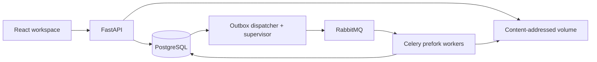

# Architecture and correctness boundaries

The application is one Python service with separate API, dispatcher, and worker processes. Nginx serves the built React app and proxies the API, refreshing Docker DNS after API restarts. Both direct dependencies and installed Python transitive dependencies are pinned; npm uses its lockfile.

## Manual CSV workflow

The main UI accepts a CSV for each source and one **Run workflow** command. `POST /api/workflows` stores both immutable files and, in one database transaction, registers both batches, their ingestion work/outbox events, the workflow's pinned input IDs, and its idempotency record. Revisions are allocated under the scope lock. Duplicate submission of the same request key reuses the same workflow; another payload under that key conflicts.

CSV-only uploads compute their byte/hash/logical-row controls from the received files and record `manifest_origin=OPERATOR`. Completeness is explicitly declared by the uploader. These controls protect file processing but do not independently prove that the producing system captured or delivered every trade. Advanced manifest uploads retain `manifest_origin=PRODUCER` and their independent expected controls. The UI labels these two origins distinctly.

The dispatcher checks pending workflows after its usual supervision transaction. Blocked inputs block the workflow; a READY pair creates a single idempotent run and attaches it atomically. Capacity pressure leaves the workflow waiting for capacity. Input IDs never change to newer deliveries while waiting. Workflow status reads join the durable run state, so browser refreshes and API/dispatcher restarts do not cancel orchestration. The two-file proxy request limit is 101 MiB, while each individual CSV remains capped at 50 MiB.

## Input lifecycle

The API spools CSV bytes to a content-addressed object, verifies that object, then registers a batch and its first work/outbox rows in a single database transaction. Uploaded filenames never become storage paths. Hashes are generated keys; hard-link creation prevents overwrites. Object creation followed by a failed database registration can leave an unreferenced artifact. Automatic garbage collection is deferred, so such objects consume disk but are never exposed as registered deliveries.

Expected delivery and batch readiness are separate. A missing file has no batch. A delivered but invalid file is BLOCKED. A valid, explicitly complete empty CSV is READY with zero accepted rows. Unknown mappings and rejected records block readiness; duplicates remain accepted evidence.

One strict CSV parser emits immutable JSON chunks with **logical data-record numbers**. It does not split on newlines, so quoted multiline records keep correct lineage. Header, encoding, field/record size, manifest row controls, positive finite quantities, decimal precision/scale, account coverage, mappings, and timezone-bearing timestamps are checked. Business date is pinned from the manifest; timestamps are converted to UTC without inferring the date from UTC.

`records` stores relational identity and numeric columns, raw fields, normalized fields, and payload hashes. Every input is normalization generation 1 with explicit `csv-v1` and `equities-v1` versions. Alternative generations and user-editable mapping/rule versions are deferred. PostgreSQL triggers reject inserts, updates, or deletes involving READY records and changes to READY batch metadata.

## Durable work and recovery

`work` represents parser jobs, chunks, preparation, partitions, finalizers, and reports. A work transition creates its outbox event in the same transaction. The supervisor promotes only a bounded window of pending work; the dispatcher locks outbox rows with `SKIP LOCKED`, sends reference-only tasks with RabbitMQ publisher confirmation, and then records dispatch success.

The broker can deliver a task more than once. A consumer claims only QUEUED/RETRYING work, increments a database-owned token, creates an attempt, and starts a heartbeat. Completed work returns without reapplying effects. Results are written in a bounded transaction and become visible together with the winning state, only after locking and checking the work's current token and state. A stale attempt rolls back all of its transaction's results. Its external chunk objects, if any, remain unreferenced and harmless.

This implementation stages results in the worker's uncommitted transaction rather than retaining a separate physical result table for each losing attempt. `comparison_groups.winning_token`, `attempts`, and `work` retain winning provenance. A paused process that still holds row locks can delay a replacement until lock timeout; database uniqueness and fencing protect correctness, while task time limits bound the delay.

The supervisor recovers expired 20-second leases, retries transient failures with bounded exponential delays, and republishes queued work with a dispatch gap. Retry budget is four attempts. Celery uses late acknowledgements, `task_reject_on_worker_lost`, and prefetch 1. Publication and report processing are idempotent under the same mechanism. RabbitMQ task status is not the application's progress authority.

Defaults: 2 worker processes; 12 queued/running work slots; 4 active runs across scopes; 5,000-record chunks; 8 partitions (API accepts 1–32); 50 MiB inputs; one million parser records; at most 100 participating records per comparison key; 20,000 current-plus-new case observations at publication. API/worker/dispatcher pools are bounded to 4 connections plus 2 overflow per process. SQL statement timeout is 60 seconds, lock timeout 10 seconds, task soft/hard limits 240/270 seconds.

## Reconciliation and publication

Each run pins both READY batch IDs, immutable rule version, code version, bucket count, and hash version. SHA-256 over canonical JSON `[scope_id, reference]`, truncated to 60 nonnegative bits, determines partition assignment; modulo is applied per run. Assignments are separate from READY source rows.

PostgreSQL groups both sources by business identity **before** a FULL OUTER JOIN. This ensures duplicate keys never create Cartesian pairings. The joined cursor streams groups to the domain comparator, which emits all duplicate families or performs exact categorical/quantity and inclusive decimal-price checks. All source members, raw strings, revisions, checksums, rules, and differences are retained. Python decimal context is explicitly widened for exact notional products. Cross-currency notional deltas are omitted.

The finalizer validates partition winners and source-record coverage, locks the scope, and rejects an older publication if a newer sequence is authoritative. Cases, observations, audit events, run status, the scope pointer, and report work are committed atomically. A failed or superseded run never updates the case projection. Inserts into completed evidence and edits/deletes of findings, groups, assignments, rules, observations, and events are protected with database triggers.

## Case semantics

Case identity is `(scope, reconciliation_ref, issue family)`. Account, instrument, price, quantity, record order, file revision, and mutable row IDs are excluded. Waiver fingerprints depend on business evidence, not source-row placement. Publication preserves assignees/notes and increments the same version used by investigator actions. Alice/Bob commands lock the case, compare the expected version, mutate it, and append an event in one transaction; stale requests return 409 with JSON-safe current values.

Detection and workflow are independent. A matching key clears and resolves a prior issue. An absent key becomes `NOT_PRESENT_IN_INPUTS` and requires review. A resolved issue that reappears reopens. A waiver requires a reason, expires after 24 hours, and becomes IN_REVIEW if its evidence changes or it expires. Manual resolution requires cleared evidence.

One conservative extension to the plan is `UNASSESSABLE`: if a previous finding is replaced by a different discrepancy (for example a price mismatch becomes a duplicate key), the old issue requires review instead of being falsely marked cleared or absent. Run diffs distinguish this state too.

Reports are independent work. A report failure preserves successful reconciliation and can be retried through `/api/demo/work/{id}` with `{"action":"retry"}`. CSV exports neutralize cells beginning with spreadsheet formulas. Source text is rendered through React text nodes, never interpreted as HTML.

## Deliberate implementation limits

- Execution mode only, one broker adapter, one predefined reference-data version, two demo investigators; no production access control.
- The database schema uses `batches` for both upload and normalization-generation metadata, and a generic `work` table for chunks/partitions/finalizers. These consolidate plan tables without conflating source identity, attempts, results, or case history.
- Transient work retries automatically. After exhausted ingestion retries, the operator supplies a new revision; after a failed run, the operator starts a fresh pinned run. A same-generation manual ingestion retry UI is not implemented.
- Publication applies per-case writes within a capped transaction. It is not yet a set-based large-volume projection writer. The benchmark reports its observed duration.
- Parsers, publication, and individual work items have time/resource caps. The 101 MiB reverse-proxy request cap accommodates two 50 MiB files and multipart overhead; the direct API additionally checks stored CSV size after Starlette has spooled the multipart body. The direct API is loopback-only in Compose.
- Generated artifacts have a separate 512 MiB cap because lineage reports can be much larger than their input CSVs. An oversized report fails independently and can be addressed without invalidating the run.
- Optional per-currency notional manifest controls, statement-plan tuning, peak-memory sampling, orphan cleanup, S3, block matching, and broader scale/concurrency experiments are deferred.

Infrastructure choices follow the primary documentation for [Celery task acknowledgement and worker loss](https://docs.celeryq.dev/en/stable/userguide/tasks.html), [PostgreSQL SELECT and locking](https://www.postgresql.org/docs/current/sql-select.html), and [RabbitMQ publisher confirms](https://www.rabbitmq.com/docs/confirms). Application-level leases, uniqueness constraints, and publication rules remain necessary alongside those mechanisms.
