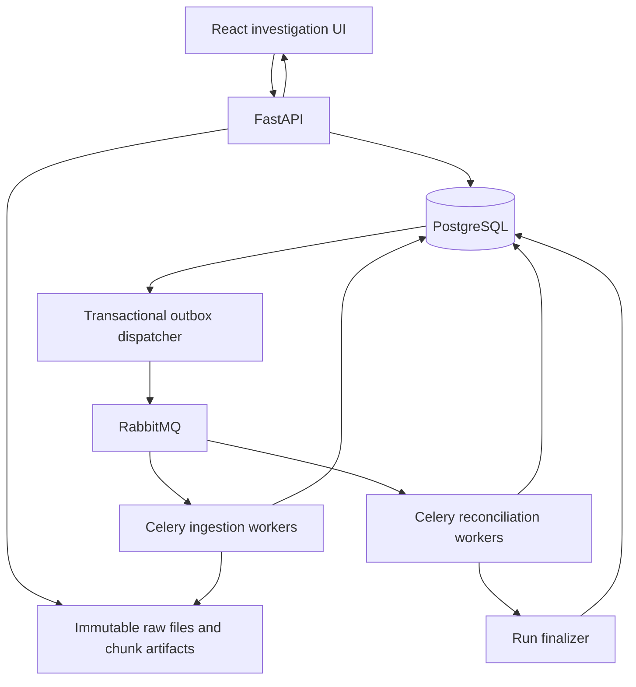

# Trade Reconciliation System — Project and Implementation Plan

Prepared: 9 November 2026  
Target: a 4–6 week interview project  
Confirmed preferences: internal and broker CSV inputs; React frontend; Python/FastAPI backend.

## 1. Project objective

Build an end-of-day trade reconciliation application that makes its entire workflow visible: receive files, validate deliveries, normalize records, reconcile fixed input versions, investigate discrepancies, and rerun after a correction.

The interview story is: **the system produces explainable results from fixed inputs, recovers safely from repeated work and failures, and preserves investigation history across reruns.**

Prioritize two qualities:

1. **Visible workflow:** a user can see what is happening, what is blocked, why a comparison failed, and how an issue was cleared.
2. **Engineering depth:** immutable inputs, exact arithmetic, duplicate detection, bounded parallel work, durable task dispatch, retries, concurrency control, deterministic results, and auditable publication.

This is an operations tool, not a trading strategy. Financial knowledge stays limited to executions, quantity, price, side, currency, and optional weighted-average fill prices.

## 2. Scope and working assumptions

### Confirmed decisions

| Topic | Decision |
| --- | --- |
| Build window | 4–6 weeks, with an end-to-end usable version by week 3–4 |
| Input sources | Internal CSV and broker end-of-day CSV |
| Backend | Python, FastAPI |
| Frontend | React with TypeScript |
| Database | PostgreSQL |
| Background processing | Celery workers with RabbitMQ |
| Deployment target | Local Docker Compose; no cloud account required |

### Defaults to implement unless changed

- Synthetic cash-equity trades; one broker initially, then a second adapter to demonstrate different input formats.
- Execution-to-execution matching first. Explicit block-to-fills mode is a later milestone.
- Each delivered revision is a **complete replacement snapshot** of its declared scope, not an incremental patch.
- A scope is `(broker_id, business_date, dataset_id)`. The dataset identifies an agreed set of accounts and the reconciliation mode.
- Both files declare the same coverage. Account mismatches inside that coverage are comparison findings; trades outside the declared coverage are validation errors.
- A shared reconciliation reference is unique across the declared broker/date scope. Where real identifiers are account-local, an adapter must provide a stable namespace; do not silently assume global uniqueness.
- No fuzzy matching in the initial version. Ambiguous identity becomes an investigation item.
- No automatic rewriting of source trades from the investigation UI. Corrections arrive as new file revisions.
- The UI represents two seeded investigator identities for demonstrating edit conflicts. This is a local demo identity mechanism, not production authentication.

### Explicitly outside the initial scope

Live trade capture, derivatives, currency conversion, settlement accounting, broker connectivity, production SSO, Kubernetes, and machine-learning matching. These are not necessary to demonstrate the requested engineering depth.

## 3. User journey and acceptance scenario

The primary user is an operations investigator.

1. Open the daily dashboard and see the expected internal and broker deliveries.
2. Upload the internal file. Its status progresses through validation, while the broker delivery remains outstanding.
3. Observe that reconciliation is blocked with an explanation. No missing-trade cases are generated yet.
4. Upload the broker file and manifest. Watch parsing and validation complete.
5. Start a reconciliation using the displayed pair of immutable batch revisions.
6. See partition progress and then matched records, missing trades, mismatches, and duplicate groups.
7. Open a case and inspect side-by-side values, rules, differences, and original file/record lineage.
8. Claim the case, add a note, and see an audit timeline.
9. Upload a corrected broker revision and explicitly start a new run.
10. See the original run remain unchanged while the new run clears the discrepancy and retains the case history.

The same application must also demonstrate a killed worker, a duplicate task delivery, and two investigators attempting conflicting edits.

## 4. System architecture



Use one repository and one backend application with separate API, worker, and dispatcher processes. Avoid independent microservices for each pipeline stage.

| Component | Responsibility |
| --- | --- |
| React | Delivery board, pipeline progress, comparison views, case workflow, demo controls |
| FastAPI | Validate requests, enforce transitions, expose durable state, authorize demo actions |
| PostgreSQL | Input metadata, normalized rows, work status, results, cases, audit, and outbox |
| Object-storage adapter | Preserve raw files and bounded intermediate chunk artifacts |
| Celery | Execute chunk ingestion, reconciliation partitions, and report generation |
| RabbitMQ | Deliver tasks; application code handles duplicate execution and result consistency |
| Dispatcher | Publish committed outbox work and recover dispatch gaps |
| Recovery supervisor | Find expired work leases and request bounded retries |

Start with a content-addressed local filesystem adapter on a shared Docker volume. Its API should allow an S3-compatible adapter later. Store bytes under generated keys, never under an untrusted uploaded path. Do not add another storage service until the first workflow works.

## 5. Input contracts and financial semantics

### Internal execution CSV

```csv
trade_id,account,instrument,side,quantity,execution_price,currency,executed_at
T1001,ACC01,ABC,BUY,100,10.60,USD,2026-11-06T14:30:00Z
T1002,ACC01,XYZ,SELL,50,25.00,USD,2026-11-06T14:31:00Z
```

### Broker execution CSV

```csv
execution_ref,client_account,symbol,buy_sell,filled_qty,fill_price,ccy,execution_time
T1001,ACC01,ABC,B,100,10.60,USD,2026-11-06T14:30:00Z
T1002,ACC01,XYZ,S,50,25.05,USD,2026-11-06T14:31:00Z
```

Adapters map both formats into a common model:

```text
batch_id, record_number, source_side,
reconciliation_ref, broker_execution_id?,
account_id, instrument_id, side,
quantity, execution_price, currency,
executed_at_utc, business_date,
raw_fields, normalized_payload_hash, canonical_key_digest
```

- Quantity is a positive decimal; direction is a separate BUY/SELL field.
- Prices and quantities use Python `Decimal` and PostgreSQL `NUMERIC`, never binary floating point. Choose explicit precision/scale and reject values outside it instead of silently rounding.
- Preserve raw strings and normalization decisions so a user can understand source differences.
- Convert aliases only through a versioned reference-data mapping. Do not guess unknown symbols or accounts.
- `business_date` comes from the delivery contract and configured business calendar/timezone; do not derive it solely from the UTC timestamp.
- Internal `execution_price` means actual execution price, not an order limit. A limit-price compliance check is a different rule and must be labelled separately if added.
- Start with quantity and execution-price comparison. Fees and settlement dates are optional later fields.

### Delivery manifest

Each demo file has an independently supplied sidecar manifest:

```json
{
  "schema_version": 1,
  "side": "BROKER",
  "broker_id": "BRK01",
  "business_date": "2026-11-06",
  "dataset_id": "equities_accounts_01",
  "revision": 1,
  "representation": "EXECUTION",
  "account_ids": ["ACC01"],
  "expected_bytes": 12345,
  "expected_data_rows": 100,
  "sha256": "<expected hash of the supplied CSV bytes>",
  "complete": true
}
```

The generator produces concrete values; the example is illustrative.

Verify expected hash, byte count, row count, supported schema, coverage, and the completion declaration. Optionally verify quantity/notional controls per currency and side.

**A checksum checks byte integrity, not business completeness.** A hash calculated only after receiving a truncated file cannot establish that trades were omitted. Expected controls must come from the producing party; even a consistent manifest is a declaration, not proof of the producer's underlying trade capture.

An explicitly declared zero-row file is valid. A file that has not arrived is not an empty dataset.

## 6. Delivery, ingestion, and input consistency

### Separate delivery state from processing state

Expected delivery:

```text
EXPECTED -> ARRIVED
EXPECTED -> OVERDUE -> ARRIVED
```

Batch processing:

```text
RECEIVED -> VERIFYING -> PARSING -> VALIDATING -> READY
                         |             |
                         +----------> BLOCKED

Transient infrastructure failures: record a retrying attempt under the current stage.
Exhausted retries: FAILED, with an operator-visible reason and explicit retry action.
```

Missing or overdue files are delivery issues. Invalid manifests and rejected rows are data-readiness issues. Missing trades are comparison findings produced only after both complete batches are ready.

### Ingestion sequence

1. Stream upload bytes into a temporary object while calculating hash and size; enforce size limits.
2. Complete the object under an immutable generated key. Verify it is readable.
3. In one database transaction, register the upload, expected-delivery association, and outbox work.
4. Parse the file using a real CSV parser into bounded, immutable chunk artifacts.
5. Validate and normalize chunks in worker processes; commit accepted rows and rejected-row details in bounded transactions.
6. Perform whole-batch checks after all required chunks complete.
7. Atomically mark the selected normalization generation `READY` only when its counts and controls agree.

If object creation succeeds but database registration fails, the object is an unreferenced artifact. A grace-period cleanup job can remove such artifacts; the UI must never claim a batch exists before registration commits.

### Parsing and readiness rules

- Use logical CSV data-record numbers as lineage. Quoted multiline fields make physical line numbers different from record numbers.
- Do not split a CSV by arbitrary bytes or newline characters. A single streaming parser creates independently processable chunk artifacts.
- Enforce maximum record size and supported encoding. A structural parse failure blocks the batch.
- Track `parsed = accepted + rejected` and verify parsed rows against the manifest.
- Rejected rows block authoritative reconciliation by default. Show valid and rejected counts, but do not publish conclusions from a silently reduced dataset.
- Duplicate trade IDs are preserved as valid parsed evidence and become duplicate findings. They are not silently deduplicated or treated like unreadable CSV.
- A valid empty delivery still requires its manifest and completeness checks.

### Immutable inputs instead of long-lived reconciliation transactions

Every run pins an internal batch generation, broker batch generation, normalization/mapping version, and comparison-rule version. READY rows and selected artifacts are immutable; new corrections create new revisions or generations.

Enforce immutability through database permissions and/or triggers, not just a comment in application code. Staging rows are writable only before their generation becomes ready.

This gives workers the same durable inputs across transactions and process restarts. It avoids keeping a PostgreSQL snapshot transaction open for the entire reconciliation.

### Optional future source: live internal database

If internal trades later come from a mutable operational database, extract a frozen input first. Use keyset pagination on a unique stable key, scoped to the correct business date, inside one `REPEATABLE READ READ ONLY` transaction. Persist the extracted rows as a new input artifact/batch before ending the extraction workflow.

The PostgreSQL snapshot is established by the first relevant statement, not merely by `BEGIN`. Its snapshot identifier is not a durable dataset that a later worker can reopen. Independent worker transactions also do not automatically share it. Persisting the extraction is the default solution here; exported snapshots are a separate, more complex option. Keep extraction bounded to avoid retaining an old snapshot unnecessarily.

## 7. Reconciliation rules

### Identity and duplicate handling

For execution mode, the comparison key is the agreed canonical reconciliation reference within the run's broker/date/dataset scope. Account, instrument, side, currency, quantity, and price are compared fields, not added to the key merely to make mismatches disappear.

Before joining, count records per key on each side:

| Internal count | Broker count | Classification |
| ---: | ---: | --- |
| 1 | 1 | Compare fields |
| 1 | 0 | MISSING_BROKER |
| 0 | 1 | MISSING_INTERNAL |
| >1 | any | DUPLICATE_INTERNAL; exclude key from ordinary pairing |
| any | >1 | DUPLICATE_BROKER; exclude key from ordinary pairing |

If both sides have duplicates, record both duplicate findings and all participating row IDs. Do not also manufacture missing/mismatch cases from an arbitrary pairing.

Differentiate three duplicate situations in the UI:

1. Re-upload of identical file bytes: idempotent upload behavior, no duplicate trade finding.
2. Redelivery of a task: idempotent worker behavior, no duplicate trade finding.
3. Repeated execution identity inside an input: a genuine duplicate finding, with identical-content or conflicting-content detail.

### Matching and comparison

Use PostgreSQL set operations for the main reconciliation. After duplicate groups are isolated, a `FULL OUTER JOIN` on unique normalized keys finds matches and one-sided records without loading both datasets into Python memory.

- Exact comparison: account, instrument, side, currency, settlement date if enabled.
- Quantity: exact for the initial whole-share fixtures; rule configuration can allow explicitly defined fractional-quantity tolerances.
- Price: `abs(internal_price - broker_price) <= absolute_price_tolerance`.
- Optional relative price tolerance: document whether combined with absolute tolerance by `max`, rather than leaving its meaning implicit.
- Timestamp: compare only if the source contract requires it; use a configured tolerance.
- Null required fields are validation failures. For optional fields, define null-versus-value semantics explicitly; SQL null comparison must not silently skip a mismatch.
- If currencies differ, report the categorical mismatch. Do not calculate a misleading cross-currency notional delta.

Emit one comparison group per key with zero or more findings. A FIELD_MISMATCH finding contains all affected fields, each side's value, delta where meaningful, tolerance, and rule identifier.

Every key must be accounted for as matched, mismatched, missing, or excluded because of ambiguity. Retain row-level membership so every accepted source row is traceable to an outcome.

### One internal block to many broker fills — second mode

Only enable this mode when the input contract supplies an unambiguous shared block reference. Do not infer grouping from coincidentally similar fields.

Example:

```text
Internal executed block: quantity 100, average execution price 106
Broker fills: 40 at 100 and 60 at 110
Broker quantity: 100
Broker weighted-average price: (40*100 + 60*110)/100 = 106
```

Group broker fills by block reference, retain their distinct execution IDs, and validate uniform account/instrument/side/currency before aggregation. Repeated execution IDs are duplicates; distinct execution IDs under the same block are legitimate fills.

Compare summed quantity and quantity-weighted execution price. Use decimal numerator/denominator arithmetic and compare before display rounding. A zero-quantity group is invalid. Missing individual fills may appear as a quantity mismatch even when the block exists on both sides.

If an internal field instead means a BUY/SELL limit, check every fill against that limit using a separately named compliance rule. Do not compare the limit to the average fill as an equality test.

## 8. Data model

Names can change during implementation, but preserve these responsibilities.

| Table | Important fields and constraints |
| --- | --- |
| `recon_scopes` | broker/date/dataset key; next run sequence; latest published run; row used to serialize publication |
| `expected_deliveries` | scope, side, deadline, arrival state; UNIQUE(scope, side) for the initial single-file-per-side contract |
| `file_uploads` | upload ID, scope, side, revision, object key, SHA-256, byte size, manifest, status; UNIQUE(scope, side, revision) |
| `input_batches` | upload ID, adapter/mapping versions, normalization generation, readiness, counts; selected generations immutable |
| `ingestion_chunks` | batch/generation, chunk number, artifact key, counts, state, current attempt; unique chunk identity |
| `normalized_records` | batch/generation, data-record number, canonical fields, raw fields, canonical-key digest; UNIQUE(batch, generation, record_number) |
| `rejected_records` | batch/generation, record number, raw fields, validation codes, offending fields |
| `rule_sets` | immutable versioned comparison, mapping compatibility, and tolerance configuration |
| `recon_runs` | scope, monotonically allocated sequence, exact input IDs, rule version, bucket count, hash version, code version, state, metrics |
| `run_record_partitions` | run, normalized-record ID, bucket ID; UNIQUE(run, record); run-specific assignments do not mutate READY inputs |
| `run_partitions` | run/bucket, state, lease, fencing token, winning attempt; UNIQUE(run, bucket) |
| `work_attempts` | task kind, work identity, attempt number, token, heartbeat, error classification, timestamps |
| `comparison_groups` | run, partition attempt, canonical key, outcome, row membership, comparison evidence |
| `findings` | group, issue type, stable finding key, field differences, evidence fingerprint |
| `cases` | stable logical case key, workflow status, detection status, assignee, first/last seen runs, row version |
| `case_observations` | run, case, observation state, finding evidence; UNIQUE(run, case) |
| `case_events` | case, actor, command/event type, reason, before/after versions, timestamp |
| `outbox_events` | event ID, task identity, payload references, dispatch attempts, next attempt time, confirmation state |
| `artifacts` | run, type, object key, checksum, state, generation time |

Use relational columns for identity, status, joins, and filtering. JSONB is appropriate for immutable raw fields and detailed field differences, not as the only structure for case history.

Important indexes include `(batch_id, generation, reconciliation_ref)`, `(run_id, bucket_id, record_id)` on run assignments, scoped case filters, run-partition state, pending outbox events, and actor-independent case-event ordering.

## 9. Runs, publication, and case history

### Run state

```text
QUEUED -> RUNNING -> FINALIZING -> SUCCEEDED
              |           |
              +---------> FAILED

An older completed run may become SUPERSEDED rather than publish.
```

Finding discrepancies is a successful reconciliation, not an infrastructure failure. Report the result outcome separately: `MATCHED` or `BREAKS_FOUND`.

No authoritative run starts until both inputs are READY. A scope with outstanding files shows `WAITING_INPUTS` in the UI rather than a fabricated completed run full of missing trades.

### Publish completed results only

Partition results are staged and labelled provisional. The finalizer verifies that every expected partition has a valid winning attempt, counts balance, input versions are still pinned, and no work failed.

In one publication transaction for the MVP:

1. Lock the scope row.
2. Reject publication if a newer run sequence is already published.
3. Attach immutable case observations for this run.
4. Update the current case projection and append system case events in deterministic key order.
5. Set the run SUCCEEDED and move the scope's published-run pointer.
6. Add report-generation work to the outbox.

If the transaction fails, nothing is partially published. A retry is idempotent. A worker from an older run cannot reopen cases after a newer run has published.

Give each publication-driven case event a deterministic unique event key. The finalizer updates detection fields and permitted workflow transitions while preserving current assignments and notes; it must not write a stale copy of the entire case row over an investigator's changes.

For the initial dataset, use set-based writes and bound the expected case volume so publication remains a short transaction. Measure its duration. Versioned case projections with an atomic generation pointer are a later scale option if this becomes a bottleneck.

### Stable cases across reruns

Use a canonical case identity such as:

```text
(broker_id, business_date, dataset_id, reconciliation_ref, issue_family)
```

FIELD_MISMATCH is one family with a list of affected fields, so correcting quantity while leaving price wrong updates evidence instead of creating an unrelated case. Duplicate findings can have separate internal/broker families.

Do not include mutable account or price values in case identity. Otherwise correcting the offending value would lose the investigation link.

`cases` is the current workflow view. `case_observations` stores what each run concluded. `case_events` stores investigator and system actions. A unique `(run_id, case_id)` prevents repeated publication within a run but does not replace the stable logical case-key constraint across runs.

### Detection and investigator workflow are different

| Dimension | States |
| --- | --- |
| Detection | PRESENT, CLEARED, NOT_PRESENT_IN_INPUTS |
| Workflow | OPEN, IN_REVIEW, RESOLVED, WAIVED |

- If the same issue persists, retain its assignee and notes; append the new observation.
- If the key now matches, mark detection CLEARED and resolve through a recorded system event.
- If a previous key is absent from both complete inputs, mark NOT_PRESENT_IN_INPUTS and require review; do not claim it matched.
- If a resolved issue reappears, reopen it and preserve history.
- A manual resolution requires evidence that the discrepancy cleared. An accepted outstanding difference uses WAIVED, with actor and reason.
- A waiver is tied to an evidence fingerprint and expiry. Changed evidence or an expired waiver requires review rather than silently accepting a different discrepancy.
- Failed, partial, or superseded runs do not mutate case workflow.

## 10. Parallel processing and recovery design

### Ingestion parallelism

One streaming parser creates stable chunk identities. A bounded dispatch window sends chunk references, not all record payloads, to worker processes. Each worker validates and normalizes a chunk and persists results with database uniqueness constraints.

Start with configurable chunk sizes around 5,000–10,000 records, a small process pool, and a bounded number of outstanding chunks. Tune from measurements rather than treating these numbers as requirements.

Once accepted rows are immutable, expensive global checks and reconciliation can query PostgreSQL directly; avoid reading every record back into Python just to send it to another worker.

### Matching parallelism

Assign both sides of the same canonical match key to the same bucket:

```text
bucket = stable_digest(canonical_scope_and_match_key) modulo bucket_count
```

Use a versioned stable hash and canonical serialization. Python's built-in `hash()` is not suitable for consistent cross-process persisted partitioning.

- Persist bucket count and hash version per run.
- Materialize run-specific record-to-bucket assignments with set-based SQL. Keep them outside normalized inputs so changing bucket count or matching mode never edits a READY batch. Choose the appropriate execution/block key before assignment; the initial implementation can store the canonical key and calculate its stable digest during this step.
- Do not hash internal/broker row IDs; they differ for the same trade.
- Partition on the block reference in block mode, not the individual fill ID.
- Whole-key grouping ensures duplicate detection also works across ingestion chunks.
- Use a fixed number of partition tasks, not one Celery task per trade.
- Protect against one oversized key/group and skew; record bucket sizes and apply a bounded group-size policy.

### Delivery guarantees and idempotency

Design for **at-least-once delivery with idempotent effects**, not an unsupported claim of exactly-once execution.

Use late acknowledgements for idempotent tasks and deliberately configure worker-loss behavior. Celery can acknowledge a lost child process even with late acknowledgements unless worker-loss rejection is configured; bounded recovery must also avoid poison-message loops. Keep authoritative work status in PostgreSQL, not only in Celery task states.

Run tasks with low prefetch for long jobs, explicit I/O timeouts, retry limits, and backoff with jitter. Distinguish transient connection/deadlock failures from permanent validation errors.

### Attempts and fencing

Each chunk/partition has a database-owned lease and monotonically increasing fencing token. An attempt heartbeats while active. Recovery may issue a new attempt when the lease expires.

Workers stage results under their attempt ID. Only a transaction that checks the current token under lock can mark that attempt successful. The finalizer reads the winning attempt only. A paused old worker that resumes cannot overwrite the new attempt's results or publish progress as current.

Use unique work/result keys so commit-then-crash-before-ack produces no duplicated logical results. Retry progress derives from committed winning work, not increment-only counters that double count executions.

Repeated ingestion of a chunk must reproduce the same normalized payload hashes. An existing logical record with different content is an invariant violation to investigate, not an instruction to overwrite a previously accepted row.

### Transactional outbox

Whenever a database transition requires background work, insert an outbox event in the same transaction. The dispatcher publishes it using publisher confirms and records dispatch state afterward.

If publishing succeeds but recording confirmation fails, it may publish again; consumers must deduplicate. A periodic supervisor scans durable pending work and expired leases, covering gaps that task delivery alone cannot resolve.

PostgreSQL row locking can coordinate dispatchers. `SKIP LOCKED` is suitable for claiming queue work, not for skipping trade rows during reconciliation.

### Concurrency limits

Bound API upload size, parsing buffers, outstanding chunks, worker concurrency, task prefetch, database connections, statement duration, and active runs. Differentiate WAITING_FOR_CAPACITY from FAILED in the UI.

The database connection budget must include API, workers, dispatcher, and finalizer processes. Increasing worker count without this budget can make the system slower or unavailable.

## 11. Investigation UI specification

The UI is a first-class deliverable from the first milestone. It must show actual durable backend state, not simulated progress.

### A. Daily operations dashboard

- Select broker, business date, and dataset.
- Two delivery cards: internal and broker, including expected deadline, selected revision, readiness, counts, and integrity checks.
- A pipeline strip: Received → Validated → Normalized → Reconciled → Published → Report ready.
- Clear blocked reasons, such as “Broker file not received” or “3 rejected records need correction.”
- Last published run beside current in-flight work; retain the old result with a visible freshness label.
- Separate trade-break totals from ingestion failures and delivery alerts.

### B. Upload and validation view

- Upload file plus manifest; display hash and revision.
- Progress by committed records/chunks and stage. No fabricated overall percentage when total work is unknown.
- Accepted/rejected counts and record-level error inspection.
- Original versus normalized values and mapping explanations.
- “Start reconciliation” enabled only for a compatible READY pair; show exact pinned inputs before submission.
- Repeated upload returns existing input metadata where equivalent. Same revision with different bytes is a conflict requiring a new revision.

### C. Run details

- Run sequence, rule/code version, input hashes, batch IDs, timestamps, and comparison mode.
- Partition tiles with queued/running/retrying/succeeded state, attempts, and processing counts.
- Stage durations, progress, retry reason, and failure details.
- Results labelled provisional until publication; completed counts include matched, missing, mismatch, and duplicate groups.
- “Compare with previous run” showing new, persisted, cleared, and no-longer-present findings.

### D. Discrepancy queue

- Server-side pagination and filtering by issue, account, instrument, assignee, workflow, and detection state.
- Columns for case ID, reference, issue type, changed fields, age, owner, and latest observation.
- Shareable filters and a link back to the run/scope.
- Counts distinguish cases from records and comparison groups.

### E. Case detail and investigation

```text
Case C123 · FIELD_MISMATCH · OPEN · last observed in R2

Field             Internal          Broker             Rule
Quantity          100               100                Exact: pass
Execution price   10.60             10.65              Tolerance 0.01: fail
Currency          USD               USD                Exact: pass

Evidence: internal.csv record 18 ↔ broker.csv record 21
Timeline: R1 detected → Alice claimed → note added → R2 still present
Actions: claim · add note · waive with reason · view source · view run
```

- Display all rows in duplicate groups and all fills in block mode.
- Give access to raw/normalized values, input revisions, rule descriptions, and observation history.
- A correction uploads a new file; the UI never edits original source evidence.
- Render source text safely and neutralize spreadsheet formula cells in exported CSV reports.

### F. Concurrent investigator edits

Each case has an integer version. Updates include the expected version; the backend uses compare-and-swap updates and appends the audit event in the same transaction.

If Alice and Bob both load version 4 and Alice claims it first, Bob receives HTTP 409 with the current case version and a “Case changed; review latest values” message. No silent last-write-wins overwrites. System-driven rerun updates increment the same version so they conflict safely with stale human edits.

### G. Demo and failure-control panel

Local-demo-only controls load a fixture, pause/release a partition, inject a bounded transient failure, and expose attempt history. A CLI/helper can actually stop a worker container for the recovery demo. Do not label a fake retry animation as a worker crash.

Make injected failures clearly visible as demo events. Disable these controls outside local-demo configuration.

### UI update mechanism

Begin with 1–2 second polling of durable progress endpoints plus query invalidation after actions. This is sufficient for EOD workflow visibility. Add server-sent events only if needed; the database remains authoritative and reconnecting clients refresh state.

## 12. API outline

| Endpoint | Purpose |
| --- | --- |
| `GET /scopes` | Daily readiness and latest published summary |
| `GET /scopes/{id}/deliveries` | Expected versus received inputs |
| `POST /uploads` | Stream file and manifest; return durable upload identity |
| `GET /batches/{id}` | Readiness, counts, validation results, lineage |
| `GET /batches/{id}/rejections` | Paginated rejected-record details |
| `POST /runs` | Start a run with exact input IDs and immutable rule version |
| `GET /runs/{id}` | Status, pinned inputs, counts, and metrics |
| `GET /runs/{id}/partitions` | Work attempts and committed progress |
| `GET /runs/{id}/results` | Paginated immutable comparison results |
| `GET /runs/{id}/diff?previous_run_id=...` | Explain changes between completed runs |
| `GET /cases` | Filtered, paginated investigation queue |
| `GET /cases/{id}` | Current projection, evidence, observations, and audit |
| `POST /cases/{id}/actions` | Version-checked claim/note/waive/review command |
| `GET /runs/{id}/report` | Report readiness and artifact access |
| `POST /demo/scenarios/{name}` | Local seeded scenario setup |

Mutating job-creation endpoints accept an idempotency key and store its request fingerprint. Same key/same payload returns the previous result; same key/different payload returns 409. An intentional rerun uses a new key and creates a new run.

Expose 202 for accepted asynchronous work, 409 for version/idempotency/readiness conflicts, and structured validation errors. UI state changes must follow committed server responses.

Report-generation failure is separate from reconciliation failure: a completed result remains available and the report job can retry independently. Reports include input hashes, rule version, totals, case evidence, and run IDs.

## 13. Edge and failure cases to demonstrate

| Scenario | Required behavior | Visible proof |
| --- | --- | --- |
| Broker file missing | Wait/overdue alert, no trade-missing flood | Delivery card and disabled run action |
| Explicit empty broker file | Reconcile only after valid complete zero-row manifest | Missing-broker findings are now legitimate |
| Truncated or corrupt upload | Integrity/row-control failure; block readiness | Manifest check details |
| Malformed row or unknown mapping | Preserve rejection and block authoritative run | Source record and error code |
| Duplicate trade across chunks | Detect at whole-key level | One duplicate group with all rows |
| Distinct partial fills | Aggregate only in declared block mode | Fill list, summed quantity, weighted price |
| Decimal edge | Compare without float artifacts | Values at, below, and above tolerance |
| Same file uploaded twice | Reuse equivalent registered input | Stable batch identity; no extra cases |
| Same revision, different contents | Reject conflicting identity | 409 and instruction to use new revision |
| Worker dies before commit | Retry without publishing partial work | New attempt and eventual correct counts |
| Worker dies after commit, before acknowledgement | Redelivery creates no duplicate effects | Same result fingerprint and case count |
| Expired worker resumes after replacement | Fencing rejects obsolete completion | Old attempt marked obsolete |
| Database temporarily unavailable | Bounded retry, backoff, clear status | Retrying stage and error history |
| Broker unavailable after request commit | Outbox remains pending and dispatch resumes | Pending dispatch becomes queued |
| Task delivered repeatedly | No duplicate results or progress inflation | Attempt log and stable logical totals |
| One partition permanently fails | Run fails without changing current cases | Old published run remains current |
| New file arrives during a run | Current run keeps old inputs; new revision is selectable | Pinned input IDs visible |
| Older run completes after newer run | Older run cannot replace published projection | SUPERSEDED state |
| Two investigators act together | One succeeds, one gets a conflict | Two browser sessions and audit history |
| Key disappears from both revisions | Require review; do not label as matched | NOT_PRESENT_IN_INPUTS observation |
| Report generation fails | Keep successful reconciliation; retry report only | Separate report status |
| Workload exceeds capacity | Bounded queues/connections; wait instead of OOM | Backlog and capacity indicators |

## 14. Testing strategy and performance evidence

Use real PostgreSQL and RabbitMQ for concurrency/recovery integration tests. An in-memory database or Celery eager mode alone cannot establish these guarantees.

### Domain and property tests

- Normalization, alias mapping, required fields, finite decimals, and tolerance boundaries.
- Order of CSV records does not affect results.
- Different valid chunk sizes, partition counts, and worker counts produce the same semantic result set.
- Every accepted row belongs to a result group or an explicit duplicate/ambiguity group.
- Duplicate input/task delivery does not add logical records or cases.
- Independent Python reference reconciliation agrees with SQL on small generated datasets.
- Block weighted-average and quantity rules, including mixed-field and duplicate-fill rejection.

### Integration and concurrency tests

- READY rows cannot be mutated.
- Outbox commit/publish gaps recover.
- Crash-before-commit and crash-after-commit-before-ack are safe.
- Stale attempt tokens and older-run finalizers cannot publish.
- Two finalizers and two investigators racing have deterministic allowed outcomes.
- Rerun observations preserve assignment, notes, reopening, and clearing rules.

### UI end-to-end tests

Use Playwright for delivery gating, mismatch inspection, concurrent edits in two browser contexts, correction/rerun history, and a recoverable background failure.

### Dataset generator

Create seeded fixtures with an expected-answer manifest. Generate cases by editing a known matched baseline, preserving a provenance record of each injected change. Include a small readable dataset and larger configurable datasets.

### Performance investigation

Measure 10k, 100k, and optionally 1m records per side on documented hardware. Use a mix of matched trades, discrepancies, and skewed keys.

Record throughput, phase durations, peak worker memory, queue depth, database connection use, retry counts, publication duration, and UI read latency under load. Compare 1/2/4 workers and multiple chunk sizes; show where database contention or coordination overhead limits scaling.

These are experiments, not promised performance figures. Separate matching time from upload, parsing, publication, and report generation. Do not fabricate benchmark numbers.

## 15. Codebase structure

```text
trade-recon/
  backend/
    pyproject.toml
    src/trade_recon/
      api/                 # routes, request/response models, error contracts
      domain/              # canonical records, keys, comparisons, state rules
      ingestion/           # CSV adapters, manifests, chunking, normalization
      reconciliation/      # SQL strategy, reference matcher, block aggregation
      cases/               # observations, commands, optimistic concurrency
      persistence/         # models, repositories, transaction boundaries
      jobs/                # Celery tasks, leases, dispatcher, recovery
      storage/             # immutable artifact interface and local adapter
      reports/             # run summaries and evidence exports
      demo/                # seeded generators and controlled failure scenarios
      observability/       # correlation IDs, logs, metrics
    migrations/
    tests/{unit,property,integration}/
  frontend/
    src/
      api/                 # generated/typed API bindings
      features/{deliveries,runs,cases,demo}/
      components/          # diff tables, badges, timelines, progress
    tests/
  fixtures/
  scripts/
  docs/
    architecture.md
    decisions/
    demo-script.md
    benchmark-report.md
  compose.yaml
  README.md
```

Keep the domain layer independent of FastAPI and Celery. Use SQLAlchemy/Alembic for schema and migrations and psycopg bulk operations where useful. React query/cache and table libraries may support polling, server-side pagination, and typed forms. Pin actual dependency versions during implementation.

PostgreSQL bulk `COPY` into staging is an optimization option after correctness; retain per-record validation and error lineage rather than relying on a bulk-load failure to explain bad data.

## 16. Milestones for 4–6 weeks

| Milestone | Build | Exit evidence |
| --- | --- | --- |
| Week 1: visible vertical slice | Compose, schema, adapters, upload, basic exact reconciliation, React dashboard and side-by-side comparison | Upload two small files and inspect one matched record and one mismatch through the UI |
| Week 2: trustworthy inputs and cases | Manifests, immutable ready batches, rejections, duplicate handling, missing-file gating, case timeline | Bad inputs block; all four discrepancy families are visible and explainable |
| Week 3: workers and durable recovery | Chunking, partitioned SQL, Celery/RabbitMQ, outbox, bounded work, attempts/fencing | Kill/retry work without duplicate results; progress survives API restart |
| Week 4: reruns and investigator concurrency | Atomic publication, stable cases, observation history, optimistic UI edits, run diff, reports | Corrected revision clears an existing case; older runs and stale edits cannot overwrite current state |
| Week 5: deeper domain and scale | Block-to-fills mode, generated edge fixtures, performance measurements and tuning | Demonstrate legitimate partial fills versus duplicates; compare worker configurations |
| Week 6: presentation polish | UI refinement, reliable demo setup, failure rehearsal, architecture decisions, final tests | Fresh checkout can run the complete demo with documented commands and no hidden manual repair |

If limited to four weeks, retain execution mode and the core correctness/recovery scenarios. Defer block mode, a second broker, advanced metrics dashboards, and S3 integration. Preserve the investigation UI and recovery proof; they are the project's main goals.

Build a demonstrable slice every week. Do not postpone the UI until all backend infrastructure is finished.

## 17. Interview demo script

Target a 10–12 minute walkthrough, adjustable to the interview format:

1. Show a missing broker delivery and explain why no missing-trade cases exist yet.
2. Upload both complete inputs; show verification and parallel work.
3. Inspect one missing trade, one price mismatch, and one duplicate group with original-row evidence.
4. Claim a case as Alice; attempt a conflicting update as Bob and show the rejection.
5. Upload a corrected revision; run again and show case continuity and the immutable prior result.
6. Run a larger fixture and actually stop a worker; show recovery without duplicate effects.
7. Explain one measurement, one design tradeoff, and one limitation.

Keep a recorded walkthrough and small offline fixtures as fallback. The live application should require no market-data connection or external credentials.

## 18. Definition of done

- A fresh checkout starts the application and dependencies with documented local commands.
- The React UI exposes the complete delivery-to-investigation workflow and truthful progress.
- Every result has input hashes, rule version, source-row lineage, and stable run identity.
- Missing, incomplete, rejected, and empty inputs have distinct behavior.
- Duplicate inputs, task delivery, retries, stale workers, reruns, and concurrent edits have tested outcomes.
- A failed/partial run cannot become authoritative or clear cases.
- A corrected input never rewrites the previous run or erases investigation history.
- Tests include actual database/message-broker integration and at least one real worker termination.
- Measured performance and remaining limitations are documented honestly.
- README links to the architecture, setup, demo script, test commands, and benchmark evidence.

## 19. Important refinements to the initial notes

1. Keep the proposed `REPEATABLE READ` batching approach for a future mutable internal source. For file inputs, immutable READY batches are simpler and replayable across worker transactions.
2. Preserve a physical row ID separately from business identity; duplicate business identities must remain representable.
3. Detect duplicates before `FULL OUTER JOIN`; joining duplicate keys directly can multiply rows and invent misleading mismatches.
4. Use expected-delivery state plus manifests and readiness gates to distinguish missing files from missing trades. Checksums alone do not establish business completeness.
5. Add `case_observations` as the explicit run-to-case link and append-only `case_events` for investigation history. A mutable observations JSON field alone is insufficient.
6. Partition by a stable canonical business key, not source row ID or Python's randomized hash.
7. Parallel workers do not automatically share a PostgreSQL transaction snapshot. Freeze inputs before distributing work.
8. RabbitMQ delivery and Celery retries do not remove the need for idempotency, durable dispatch, bounded recovery, and stale-worker fencing.
9. Block aggregation is valid only under explicit representation and price semantics. A limit price is not an average execution price.
10. Publish cases only from a complete authoritative run; keep provisional progress visible but labelled.

## 20. Implementation references

These primary references support the infrastructure choices. Project-specific contracts and invariants above remain application responsibilities.

- [PostgreSQL transaction isolation](https://www.postgresql.org/docs/current/transaction-iso.html): snapshot behavior and isolation semantics.
- [PostgreSQL SELECT and locking clauses](https://www.postgresql.org/docs/current/sql-select.html): join and work-claiming primitives.
- [PostgreSQL COPY](https://www.postgresql.org/docs/current/sql-copy.html): bulk staging operations.
- [Celery tasks](https://docs.celeryq.dev/en/stable/userguide/tasks.html): idempotent tasks, acknowledgement configuration, retries, and worker-loss behavior.
- [RabbitMQ acknowledgements and publisher confirms](https://www.rabbitmq.com/docs/confirms): producer and consumer delivery responsibilities.
- [S3 integrity checks](https://docs.aws.amazon.com/AmazonS3/latest/userguide/checking-object-integrity.html): byte-integrity checks for an optional object-store adapter.

